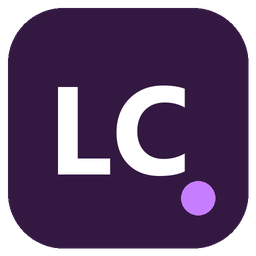
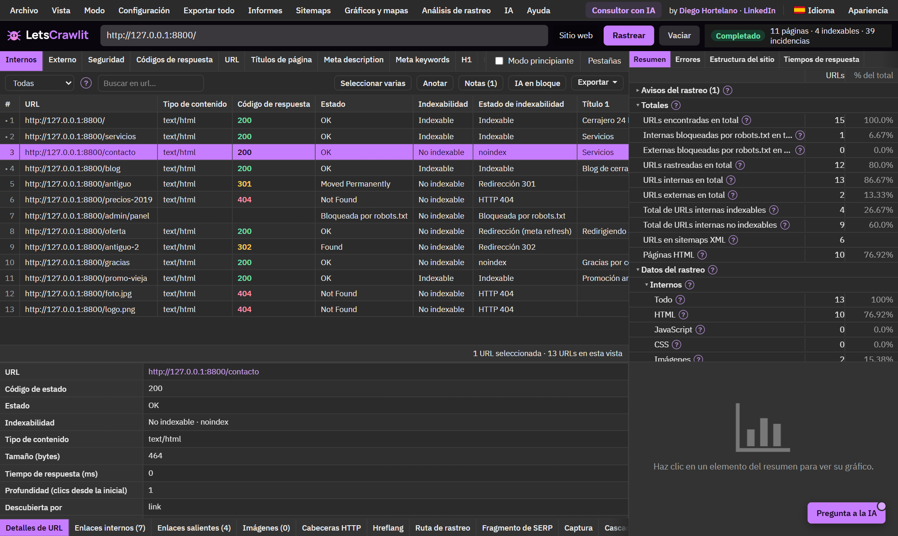
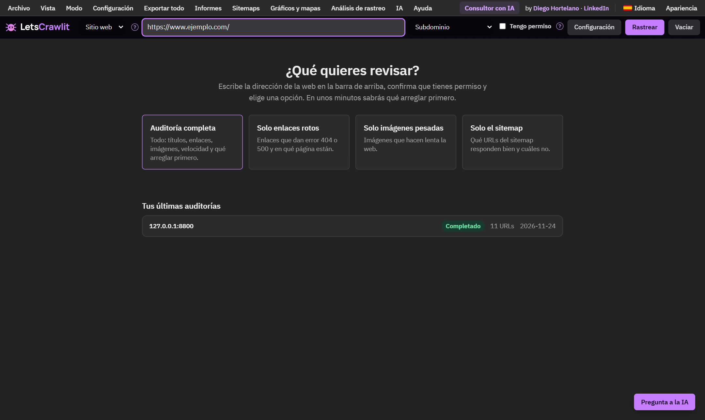
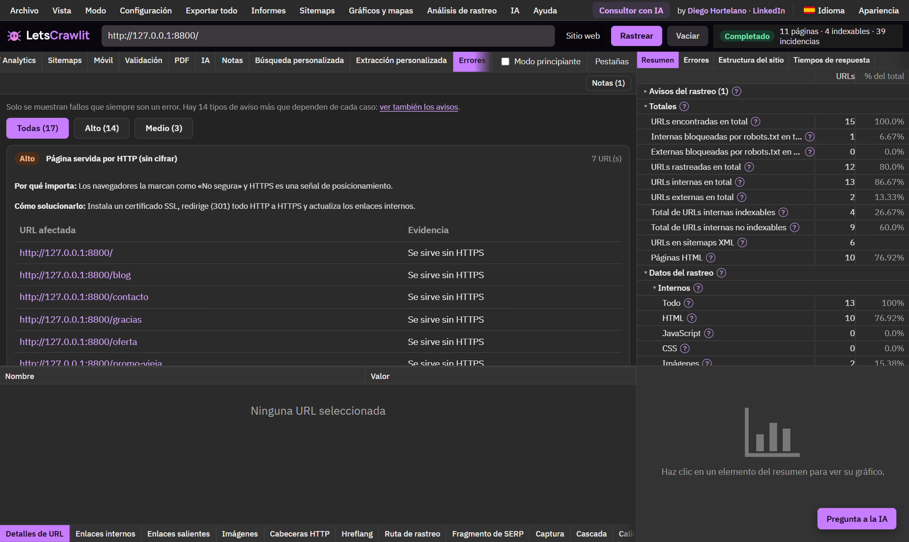
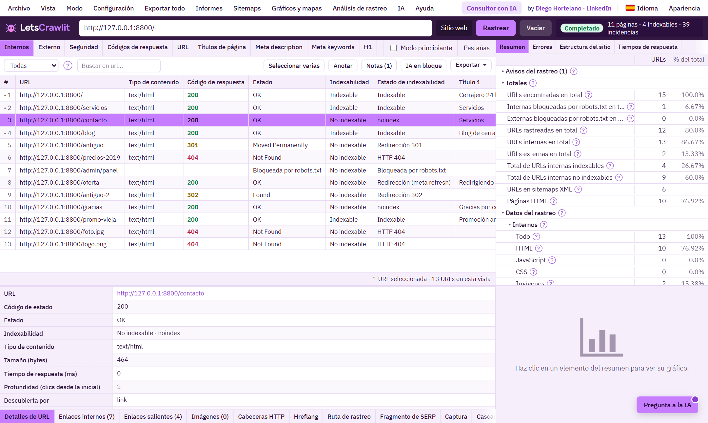
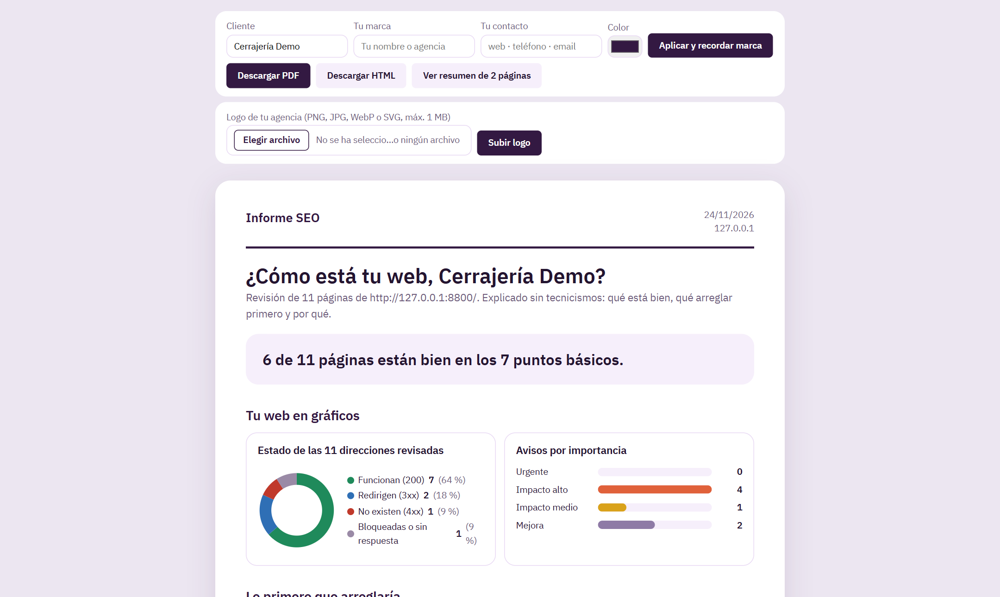
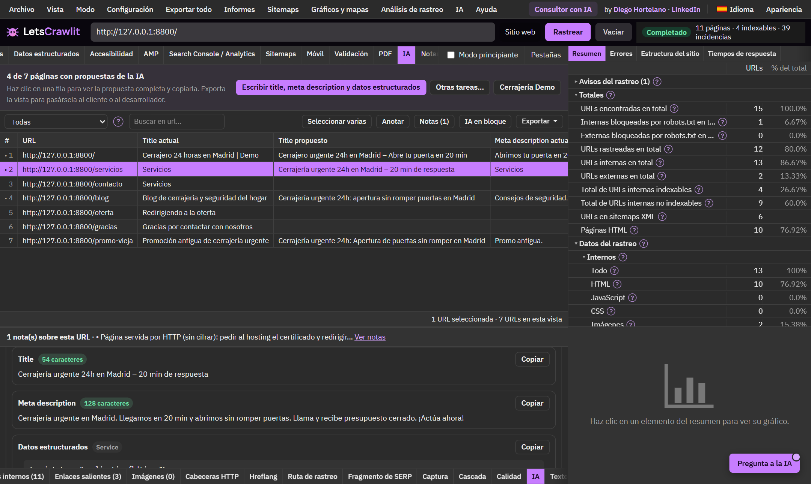
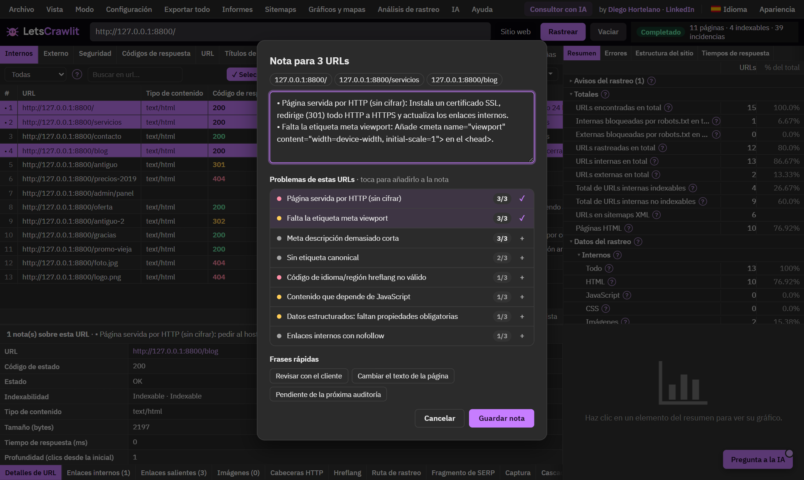
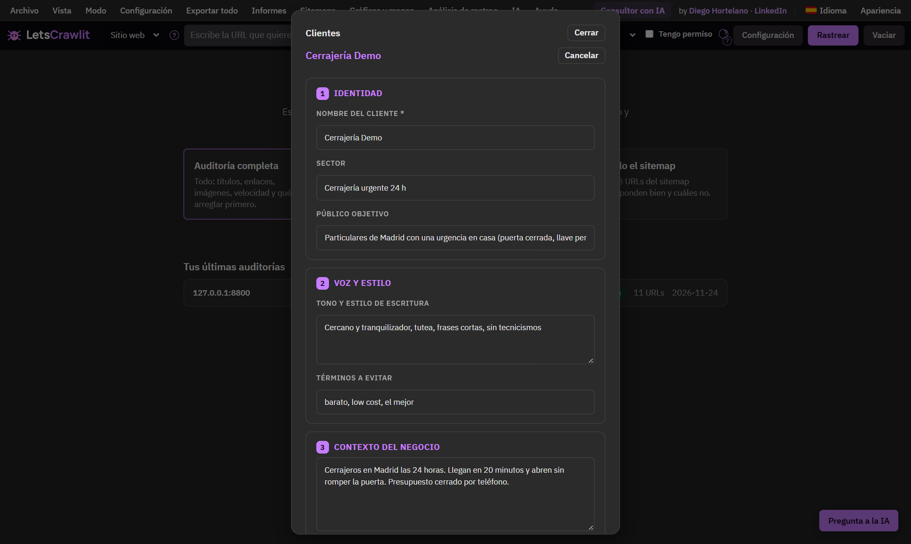

<p align="center">
  
</p>

<h1 align="center">LetsCrawlit</h1>

<p align="center">
  <b>Auditorías SEO técnicas desde tu ordenador. Gratis y de código abierto.</b><br>
  Rastrea una web, encuentra los problemas, los ordena por prioridad y explica cómo arreglar cada uno.
</p>

<p align="center">
  <a href="https://github.com/diego-hortelano-seo/letscrawlit/releases/latest/download/LetsCrawlit-Setup.exe"><b>Descargar para Windows</b></a>
  &nbsp;·&nbsp; Windows 10 y 11
  &nbsp;·&nbsp; Español, English, Français, Italiano, Português, Deutsch
</p>

<p align="center">
  
</p>

## Qué hace

- **Rastrea la web como un buscador.** Sigue los enlaces internos y el sitemap, y puede renderizar JavaScript.
  Respeta siempre robots.txt y va a un ritmo que no molesta al servidor.
- **Encuentra los problemas técnicos:** enlaces rotos, errores 404 y 500, redirecciones en cadena, títulos y
  descripciones, encabezados, canonicals, indexación, hreflang, imágenes pesadas, datos estructurados,
  seguridad, ortografía y más (y SEO local, si lo activas).
- **Separa lo que siempre es un error de lo que depende de cada caso**, y para cada problema dice por qué importa y
  cómo se arregla.
- **Prepara informes para clientes** en lenguaje sencillo, con tu marca y tu logo: PDF, HTML, PowerPoint y Excel.
- **Compara auditorías** y muestra la evolución de una web con el tiempo.
- **Anota mientras auditas:** marca varias URLs, pulsa «Anotar» y añade con un clic los problemas que comparten. Las
  notas pasan al informe del cliente.
- **IA opcional, con tus instrucciones:** escribe el title, la meta description y los datos estructurados de las
  páginas que elijas, con el tono de cada cliente (fichas de cliente), y un consultor SEO al que preguntar. Con tu
  propia clave (Claude, OpenAI, Gemini, Groq) o con un modelo en tu equipo (Ollama).

## Privado y respetuoso

- **Todo se queda en tu ordenador.** Sin cuentas, sin suscripción y sin telemetría.
- **Solo rastrea con permiso.** Antes de cada rastreo confirmas que la web es tuya o que tienes permiso para
  revisarla.
- **Nunca se salta robots.txt** ni hace cambios en ninguna web: solo lee.
- Los servicios externos (IA, PageSpeed, Search Console, Analytics) son opcionales, están apagados por defecto y
  solo se usan cuando tú lo pides.
- Al abrirse, la app pregunta a GitHub si hay una versión nueva (como mucho cada 12 horas) para avisarte. No envía
  nada tuyo, y se desactiva en **Vista › Avisar de versiones nuevas**.

## Instalar

1. Descarga **[LetsCrawlit-Setup.exe](https://github.com/diego-hortelano-seo/letscrawlit/releases/latest/download/LetsCrawlit-Setup.exe)** y ábrelo.
2. Sigue el asistente: tarda un minuto y no pide permisos de administrador.
3. Abre LetsCrawlit, escribe la dirección de la web, marca «Tengo permiso» y elige qué quieres revisar.

Windows puede avisar «Windows protegió su PC» la primera vez, porque el programa todavía no está firmado.
Pulsa **Más información** y después **Ejecutar de todas formas**.

Cuando haya una versión nueva, la app te lo dirá con un aviso. Para actualizar, instala la versión nueva encima: tus auditorías, notas y claves se guardan en
`%APPDATA%\LetsCrawlit` y no se pierden. Se desinstala desde **Configuración › Aplicaciones** de Windows.

## Capturas

| Pantalla de inicio | Errores, con el porqué y cómo arreglarlos |
|---|---|
|  |  |
| **Modo claro** | **Informe para el cliente** |
|  |  |
| **La IA propone title, description y datos estructurados** | **Anotar varias URLs a la vez** |
|  |  |
| **Ficha de cliente para la IA** | |
|  | |

Las capturas son de una web de prueba local con errores a propósito (`extras/demo/demo_site.py`). Las propuestas
de la IA son reales (Groq, `openai/gpt-oss-20b`) con la ficha de cliente de la captura.

## Guías

Las guías completas (primeros pasos, tutoriales y cada pestaña explicada) estarán en
**[letscrawlit.com](https://letscrawlit.com/)**, próximamente. Mientras tanto, la app trae lo básico para empezar en
**Ayuda › Manual de uso**.

## Desde el código

Requisito: Python 3.12.

```bash
py -3.12 run.py
```

La primera vez crea el entorno, instala las dependencias y abre la app en <http://127.0.0.1:8765/>.
En macOS y Linux: `python3.12 run.py`. Los tests se lanzan con `py -3.12 run.py test`.

Para crear el instalador de Windows:
`pip install -r requirements.txt -r requirements-build.txt`, `python -m PyInstaller letscrawl.spec` y, con
[Inno Setup 6](https://jrsoftware.org/isinfo.php), `iscc /DMyVersion=<versión> packaging\letscrawl.iss`.
Al subir una etiqueta de versión (`git tag vX.Y.Z && git push origin vX.Y.Z`), GitHub lo crea solo y lo publica
en Releases.

Stack: Python · FastAPI · SQLite · Playwright · htmx, todo servido en local.

La **[referencia técnica](docs/REFERENCIA.md)** explica cada opción, la línea de comandos, la integración continua,
la seguridad, dónde se guardan los datos y cómo está organizado el código.

## Contribuir

Las sugerencias y los fallos se reciben en [Issues](https://github.com/diego-hortelano-seo/letscrawlit/issues).
Si encuentras un fallo de seguridad, avísame en privado antes de publicarlo.

## Licencia y autor

[MIT](LICENSE) © 2026 [Diego Hortelano](https://diegohortelano.com/) ·
[LinkedIn](https://www.linkedin.com/in/diego-hortelano-hidalgo/)

Incluye [htmx](https://htmx.org/) (BSD 2-Clause) y la fuente [IBM Plex Sans](https://github.com/IBM/plex)
(SIL Open Font License 1.1). Proyecto independiente, sin relación con ninguna otra herramienta de rastreo SEO.
